# Instalador RedRise 0.1.0-beta.32 — passo a passo com capturas reais

- **Versão fotografada:** `RedRise-Setup-0.1.0-beta.32.exe`, SHA-256 `93601c7324833f00b8ff219ff54a91472e04a6631894e5ef9ae2cb1052811d64`, 311.083.974 bytes (instalador RedRise 0.2.1 com o assistente InstallRS 0.1.1). É o mesmo arquivo aprovado no gate ([verification.json](verification.json)), assinado no canal local e instalado na máquina real.
- **Quando e onde:** 12/11/2026, das 05:43 às 05:49, no laboratório sintético (`lab-test`), com o computador ocioso. Cada cenário usou uma pasta de instalação isolada (`lab-test\wizard\<cenário>\Programs\@redrise`) e a equipe de teste do laboratório. A instalação real não foi usada para tirar capturas.
- **Como:** o roteiro `proofs/process-actions/accept_actions.py` (cenários `wizard_*`) abriu o instalador e operou o assistente pela UI Automation. Cada passo foi registrado no relatório [accept-actions-20261112-054953.json](accept-actions-20261112-054953.json) (todos `passed: true`). As imagens são da janela real, sem montagem.
- **Sem segredos:** nenhuma senha aparece (o campo Senha mostra só pontos). O código da equipe do laboratório foi coberto na captura 13. As contas e estações são sintéticas.
- **Hashes:** o SHA-256 de cada captura está em [evidence.json](evidence.json) (`artifacts`).

Na instalação real, o destino padrão é `%LOCALAPPDATA%\Programs\@redrise` (por usuário, sem senha de administrador). As pastas `lab-test\wizard\…` aparecem nas capturas só porque são as raízes isoladas do teste.

## Servidor da equipe (computador novo)

| # | Captura | Papel | Ação executada | Resultado observado |
|---|---|---|---|---|
| 1 | <a href="shots/wizard-01-boas-vindas.png">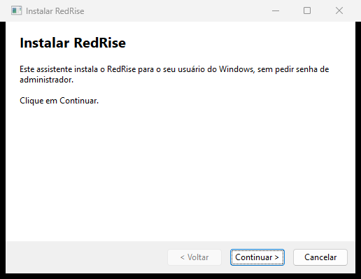</a> | — | Abrir o instalador. | Página **Instalar RedRise**: instala para o usuário do Windows sem pedir senha de administrador; Voltar desabilitado. |
| 2 |  | — | Continuar. | **Como este computador será usado?** explica servidor e estação; o campo começa em "Escolha uma opção", sem pré-seleção. |
| 3 | <a href="shots/wizard-03-escolha-obrigatoria.png">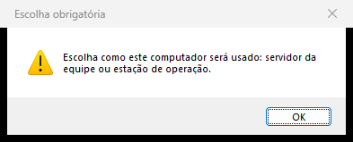</a> | — | Continuar sem escolher. | Aviso **Escolha obrigatória**; o assistente não avança. |
| 4 | <a href="shots/wizard-04-uso-servidor-escolhido.png">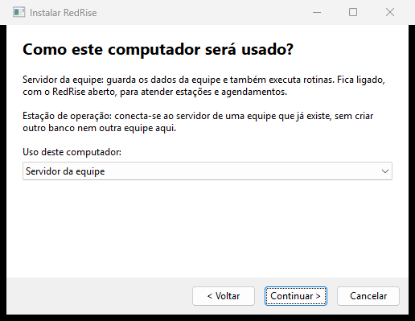</a> | Servidor | Escolher **Servidor da equipe**. | A escolha aparece no campo. |
| 5 | <a href="shots/wizard-05-pronto-servidor.png">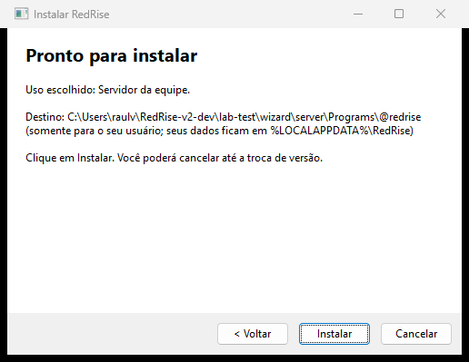</a> | Servidor | Continuar. | **Pronto para instalar**: uso escolhido, destino por usuário, dados em `%LOCALAPPDATA%\RedRise`, "Você poderá cancelar até a troca de versão". |
| 6a |  | Servidor | Instalar. | Progresso real: "Copiando e conferindo arquivos (1 de 3759)"; Cancelar disponível. |
| 6b | <a href="shots/wizard-06-progresso-2.png">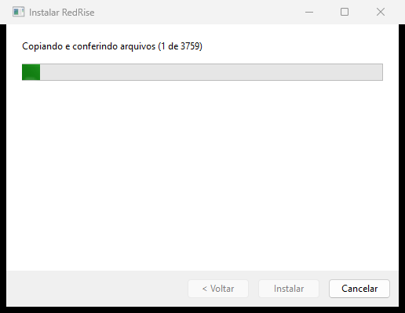</a> | Servidor | — | Barra avançando no mesmo passo. |
| 6c | <a href="shots/wizard-06-progresso-3.png">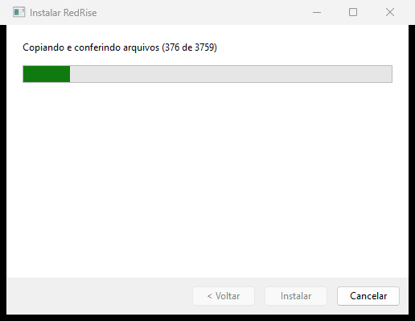</a> | Servidor | — | "276 de 3759" durante a cópia conferida. |
| 7 | <a href="shots/wizard-07-concluido-servidor.png">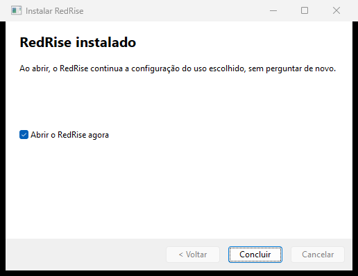</a> | Servidor | Aguardar o fim. | **RedRise instalado**; "Abrir o RedRise agora" marcado. Registro: 3.758 arquivos, `setup_intent: server`. |
| 8 | <a href="shots/inst-wizard-08-primeira-abertura-servidor.png">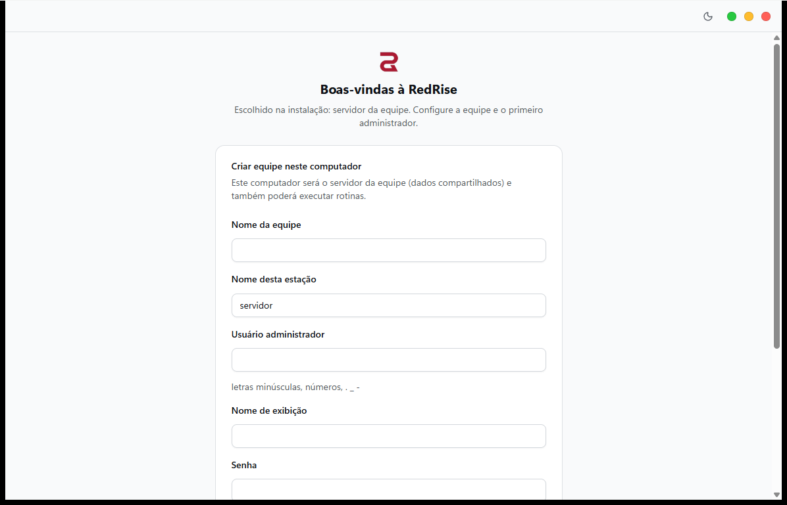</a> | Servidor | Concluir com o app aberto. | Primeira abertura: "Escolhido na instalação: servidor da equipe", com o formulário **Criar equipe neste computador**. O uso não é perguntado de novo. |

## Cancelamento e computador já configurado

| # | Captura | Papel | Ação executada | Resultado observado |
|---|---|---|---|---|
| 9 | <a href="shots/wizard-09-cancelado-durante.png">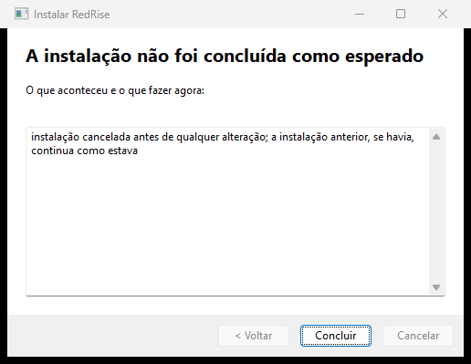</a> | Servidor (sobre uma instalação existente) | Cancelar durante o progresso, antes da troca. | **A instalação não foi concluída como esperado**: "instalação cancelada antes de qualquer alteração". A instalação anterior ficou como estava e não sobrou staging. Antes disso, cancelar na página de uso (que voltou com Servidor da equipe pré-selecionado pela intenção ainda não consumida) só fechou o assistente (`cancelled: true`). |
| 10 | <a href="shots/wizard-10-ja-configurado.png">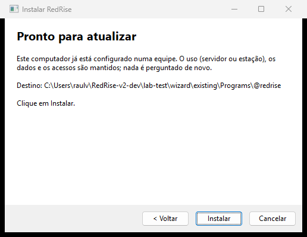</a> | Mantido | Abrir o instalador num computador já configurado. | **Pronto para atualizar**: uso, dados e acessos mantidos, nada é perguntado. Registro: `configuration: existing (role kept)`; a intenção do laboratório ficou inalterada. |

## Estação de operação

| # | Captura | Papel | Ação executada | Resultado observado |
|---|---|---|---|---|
| 11 | <a href="shots/wizard-11-pronto-estacao.png">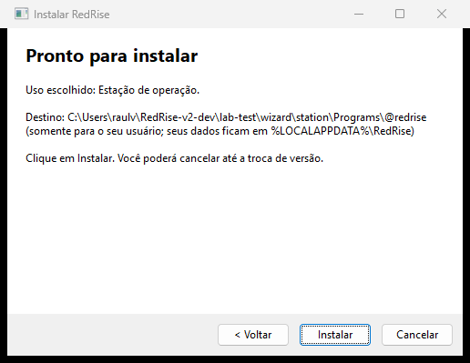</a> | Estação | Escolher **Estação de operação** e continuar. | **Pronto para instalar** com "Uso escolhido: Estação de operação". |
| 12 | <a href="shots/inst-primeira-abertura-estacao.png">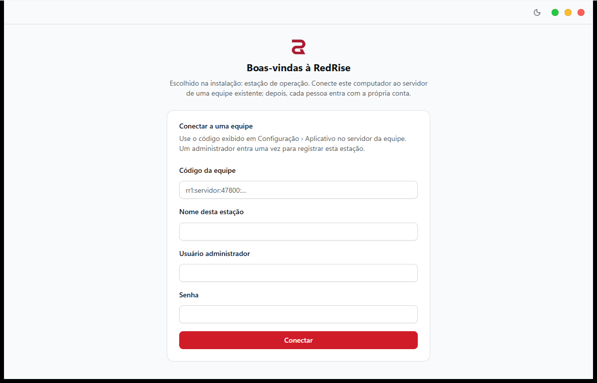</a> | Estação | Concluir com o app aberto. | Primeira abertura só com **Conectar a uma equipe** (código da equipe, nome da estação, administrador). Não oferece criar equipe nem servidor local. |
| 13 | <a href="shots/inst-estacao-conexao-pendente.png">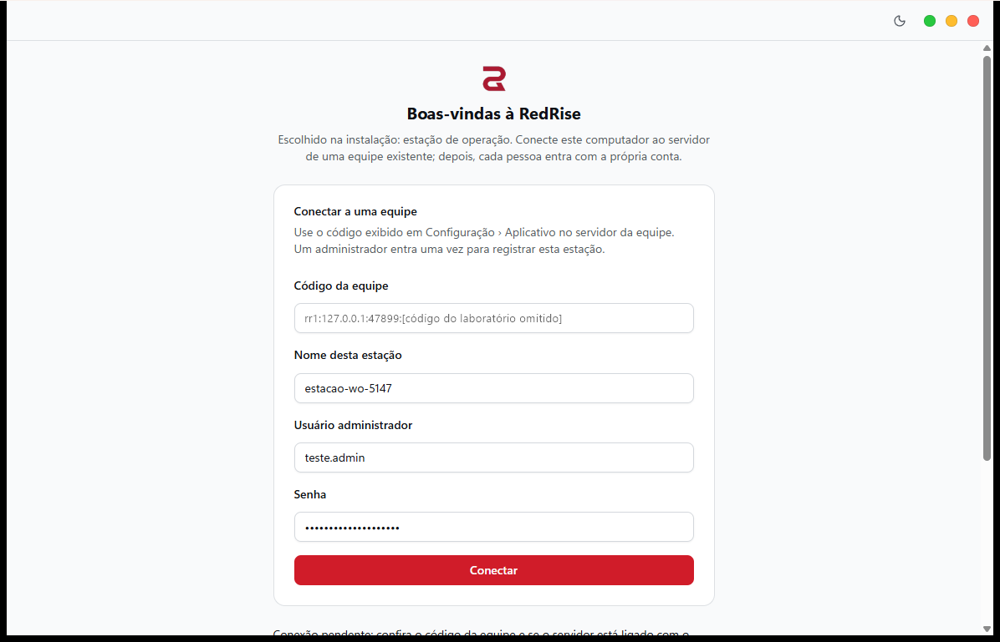</a> | Estação | Conectar com o servidor indisponível. | "Conexão pendente: confira o código da equipe e se o servidor está ligado…"; nenhum servidor local é criado. O código do laboratório foi coberto nesta cópia. |
| 14 | <a href="shots/inst-estacao-conectada-login.png">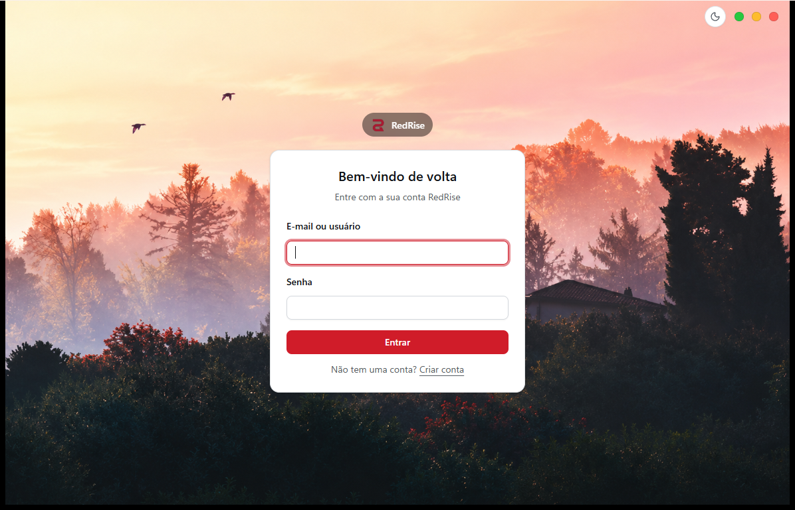</a> | Estação | Conectar com o Core do laboratório ligado. | Estação `estacao-wo-5147` registrada (id 14). O app vai para **Bem-vindo de volta**, onde cada pessoa entra com a própria conta. A intenção foi consumida. Escopo: duas instalações isoladas neste computador, não uma segunda máquina, LAN ou VPN. |

## Erro controlado depois da troca de versão (item 4.2)

| # | Captura | Papel | Ação executada | Resultado observado |
|---|---|---|---|---|
| 15 | <a href="shots/wizard-15-erro-controlado.png">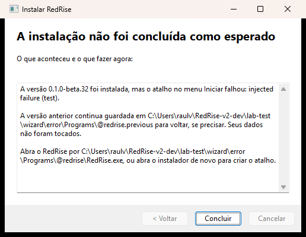</a> | Servidor (sobre uma instalação existente) | Instalar com falha injetada no atalho do menu Iniciar (`--test-fail-at after-swap`, aceito só em raiz isolada). | **A instalação não foi concluída como esperado**: "A versão 0.1.0-beta.32 foi instalada, mas o atalho no menu Iniciar falhou". Informa onde está a versão anterior, que os dados não foram tocados e como abrir o RedRise. O registro JSON (`phase: after_swap`, `step: shortcut`, `installed_now: 0.1.0-beta.32`) e a pasta concordam. |

As outras falhas (antes da troca, na troca, na restauração, na gravação da intenção e numa instalação nova) foram provadas sem janela, em cópias: [accept-actions-failures-20261112-014408.json](accept-actions-failures-20261112-014408.json). Em todas, a mensagem, o JSON e os arquivos concordam.

As capturas da beta.31 continuam em `../PROCESS-LIST-INSTALLER-20261110/shots/wizard-*.png`. Esta página registra a versão final desta entrega.
